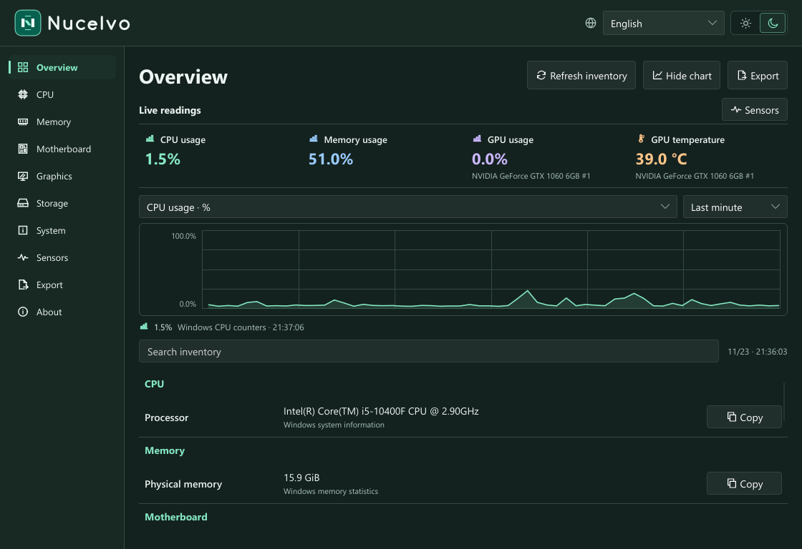

<h1>
  <picture>
    <source media="(prefers-color-scheme: dark)" srcset="assets/brand/nucelvo-logo-dark.svg">
    
  </picture>
</h1>

**See what's inside your PC and how it's running.** Nucelvo is a free, open-source desktop app for hardware inventory, live sensor monitoring, and diagnostic reports. Core monitoring works offline and requires no account.

[Download for Windows](#-download-for-windows) · [Run from source](#-run-from-source) · [Contribute](#-contribute) · [Ask a question](https://github.com/informigados/nucelvo/discussions)

**Preview availability:** Windows 11 x64 installer and portable ZIP. Ubuntu 24.04 source builds were tested under X11 and Wayland. See [platform and sensor coverage](docs/compatibility.md).

## ⬇️ Download for Windows

[Windows x64 installer](https://github.com/informigados/nucelvo/releases/download/v0.7.2/nucelvo-0.7.2-windows-x64-setup.exe) · [Portable ZIP](https://github.com/informigados/nucelvo/releases/download/v0.7.2/nucelvo-0.7.2-windows-x64-portable.zip) · [Release notes](https://github.com/informigados/nucelvo/releases/tag/v0.7.2)

The installer runs for the current user. For the portable edition, extract the ZIP and open `nucelvo.exe`. Installed Windows x64 copies can check for updates from **About**.

<details>
<summary>Verify the download and read about SmartScreen</summary>

Download the installer from the [official GitHub release](https://github.com/informigados/nucelvo/releases/tag/v0.7.2). In PowerShell, run this command from the download folder and compare the output with `SHA256SUMS` attached to the release.

```powershell
Get-FileHash .\nucelvo-0.7.2-windows-x64-setup.exe -Algorithm SHA256
```

For the **0.7.2 Windows x64 installer**, the published SHA-256 is `a9830f0acc67c840baaf14f467dbf2aed25b623cfccf3d1a617b4420db27ef3d`.

### Microsoft Defender SmartScreen

The Windows installer is unsigned. Microsoft Edge may show a reputation warning if the file is uncommon or unrecognized. If you choose to keep the official installer after checking its source and SHA-256, open the download item's **…** menu, select **Keep**, and select **Keep anyway** under **Show more** if that option is available. Leave SmartScreen enabled and follow any malware warning or organization policy. [Microsoft Edge SmartScreen documentation](https://learn.microsoft.com/en-us/deployedge/microsoft-edge-security-smartscreen)

</details>

## 🖥️ What you can do



- **Identify components.** Search and copy details about your CPU, RAM, motherboard, GPU, drives, and network adapters.
- **Follow live readings.** See usage and available temperatures, clock speeds, fan speeds, GPU power, and network throughput. View session statistics and up to 15 minutes of history.
- **Review drive and memory health.** See supported SMART data such as power-on hours, SSD endurance used, and drive alerts. Review recorded Windows memory diagnostic results or Linux EDAC error counters when available.
- **Share diagnostic reports.** Export JSON, TXT, CSV, or standalone HTML. The default **Share-safe** option omits serial numbers, volume names, and volume paths.
- **Make it yours.** Use light or dark mode and switch between English and Brazilian Portuguese.

## 🚀 Run from source

Install [Rust with rustup](https://rustup.rs/). This project pins its toolchain in [rust-toolchain.toml](rust-toolchain.toml).

**Windows 11 x64** · Install the MSVC C++ build tools and Windows SDK.

**Ubuntu 24.04 x86_64** · Install the build and desktop dependencies.

```sh
sudo apt-get update
sudo apt-get install build-essential pkg-config libfontconfig1-dev libxkbcommon-dev \
  libxkbcommon-x11-0 libx11-xcb1 libxcursor1 libxi6
```

The Linux file chooser uses the desktop portal, with Zenity as a fallback. Install `zenity` if your desktop lacks a file chooser portal and `xdg-utils` to use **Open folder**.

Clone the repository and run the desktop app:

```sh
git clone https://github.com/informigados/nucelvo.git
cd nucelvo
cargo run --locked
```

## 🤝 Contribute

- Pick a [good first issue](https://github.com/informigados/nucelvo/contribute) and follow the [contribution guide](CONTRIBUTING.md) to build and test your changes.
- Open [Discussions](https://github.com/informigados/nucelvo/discussions) for questions or to share hardware compatibility feedback. Use the [issue chooser](https://github.com/informigados/nucelvo/issues/new/choose) for bugs, feature requests, or accessibility barriers.

If Nucelvo helps you, star the repository so you can find it again.

## 📚 Project resources

| Resource | What it covers |
| --- | --- |
| [Compatibility](docs/compatibility.md) | Platform support and hardware coverage |
| [Changelog](CHANGELOG.md) | Changes by release |
| [Contributing](CONTRIBUTING.md) | Development checks, bug reports, and pull requests |
| [Code of conduct](CODE_OF_CONDUCT.md) | Community behavior and moderation |
| [Accessibility](ACCESSIBILITY.md) | Supported workflows and how to report barriers |
| [Security policy](SECURITY.md) | How to report a vulnerability privately |
| [Translations](translations/README.md) | Updating and reviewing language catalogs |

## 📄 License and credits

Built by **INformigados** and **Alex Brito**.

Nucelvo’s source code is licensed under [Apache 2.0](LICENSE). The desktop interface uses Slint under its Royalty-free License 2.0. See the [third-party notices](THIRD_PARTY_NOTICES.md) and [brand assets](assets/brand/README.md).

<a href="https://slint.dev/">
  
</a>
